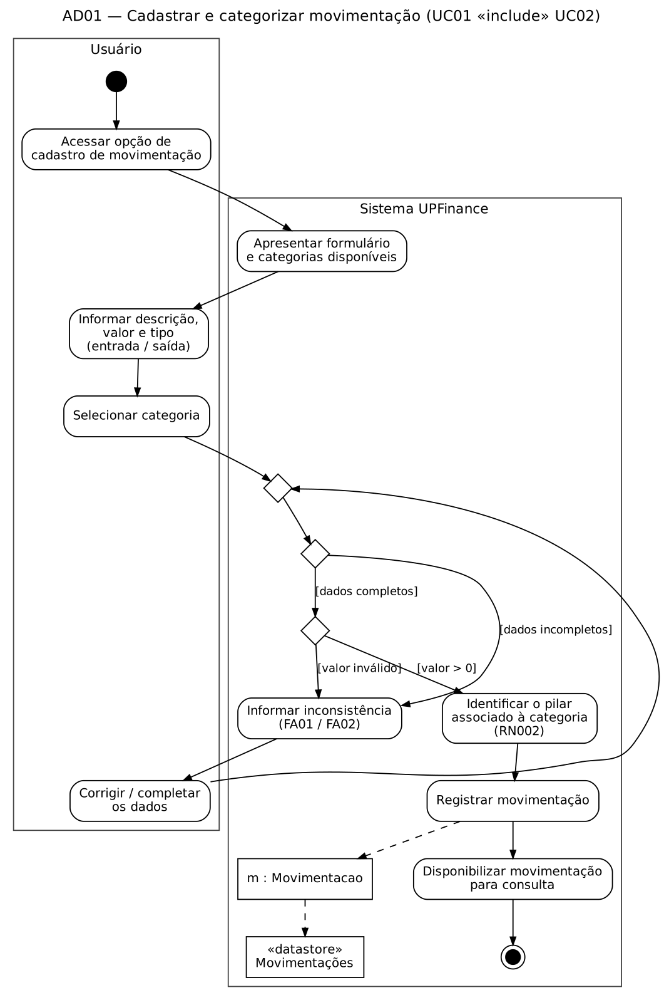
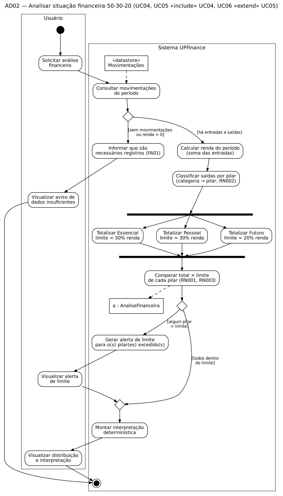
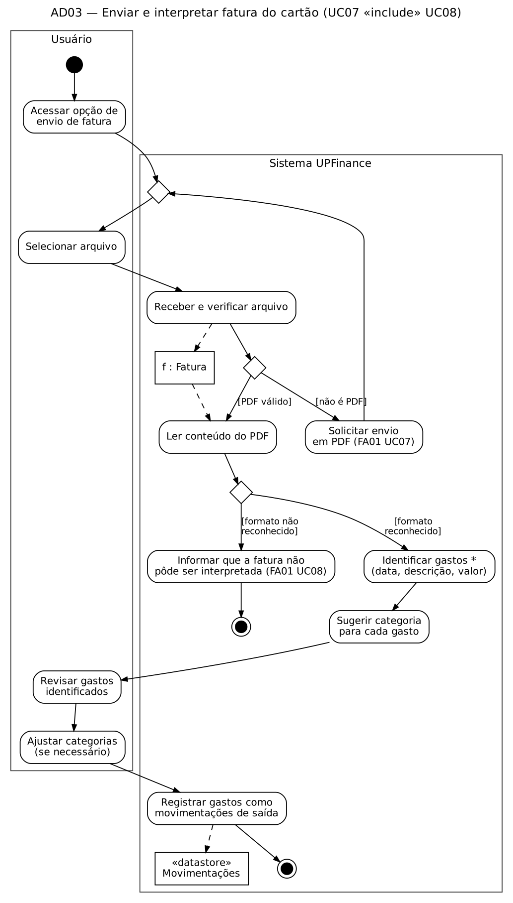
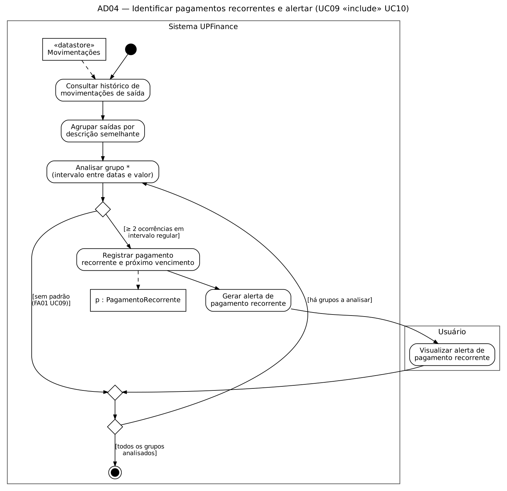
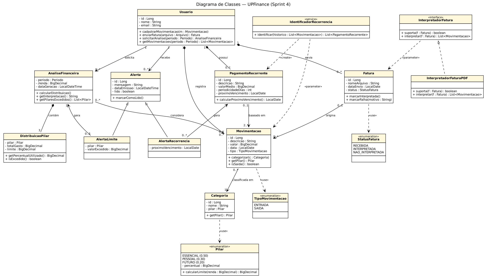

# Sprint 4 - Diagramas de Atividades e Diagrama de Classes (UML)

## 1. Objetivo da Sprint

A Sprint 4 tem como objetivo aprofundar a modelagem da UPFinance em duas perspectivas complementares da UML:

- **Comportamental (dinâmica):** diagramas de atividades que representam o fluxo de trabalho dos casos de uso especificados na Sprint 3, incluindo decisões, fluxos alternativos, paralelismo e fluxo de objetos.
- **Estrutural (estática):** diagrama de classes que representa os conceitos do domínio da UPFinance, seus atributos, operações e relacionamentos.

Os diagramas foram derivados diretamente dos requisitos funcionais (Sprint 2) e da especificação dos casos de uso (Sprint 3), mantendo a rastreabilidade RF → UC → Diagrama de Atividades → Classes.

---

## 2. Diagramas de Atividades

### 2.1 Critério de agrupamento

Os dez casos de uso foram agrupados em quatro diagramas de atividades, seguindo os relacionamentos `<<include>>` e `<<extend>>` definidos na Sprint 3. Casos de uso que sempre ocorrem juntos são representados no mesmo fluxo.

| ID | Diagrama de atividades | Casos de uso | Requisitos | Regras de negócio |
|---|---|---|---|---|
| AD01 | Cadastrar e categorizar movimentação | UC01, UC02 | RF001, RF002, RF003 | RN002 |
| AD02 | Analisar situação financeira 50-30-20 | UC04, UC05, UC06 | RF005, RF006, RF007 | RN001, RN003, RN004 |
| AD03 | Enviar e interpretar fatura do cartão | UC07, UC08 | RF008, RF009 | — |
| AD04 | Identificar pagamentos recorrentes e alertar | UC09, UC10 | RF010, RF011 | — |

O UC03 (Visualizar movimentações) não recebeu diagrama próprio por ser um fluxo linear de consulta (acessar → consultar → apresentar), sem decisões relevantes além do FA01, que já está coberto pela especificação textual.

### 2.2 Elementos utilizados

| Elemento | Notação | Uso na UPFinance |
|---|---|---|
| Estado inicial / final | ● / ◉ | Início e término de cada fluxo |
| Atividade | Retângulo arredondado | Ações do usuário ou do sistema |
| Decisão / Merge | Losango | Validação de dados, limite excedido, formato da fatura |
| Condição de guarda | `[texto]` | `[valor inválido]`, `[algum pilar > limite]` |
| Fork / Join | Barra preta | Totalização paralela dos três pilares (AD02) |
| Raias (swimlanes) | Partições | **Usuário** e **Sistema UPFinance** |
| Objeto | Retângulo | `Movimentacao`, `Fatura`, `AnaliseFinanceira`, `PagamentoRecorrente` |
| Datastore | `«datastore»` | Base de movimentações |
| Concorrência dinâmica | `*` | "Identificar gastos *" e "Analisar grupo *" (repetição por item) |

---

### 2.3 AD01 — Cadastrar e categorizar movimentação



**Descrição do fluxo:**

1. O usuário acessa a opção de cadastro; o sistema apresenta o formulário e as categorias disponíveis.
2. O usuário informa descrição, valor e tipo (entrada/saída) e seleciona uma categoria.
3. O sistema valida os dados:
   - `[dados incompletos]` → FA01 do UC01: o sistema informa a inconsistência e o usuário corrige.
   - `[valor inválido]` → FA02 do UC01: o sistema solicita a correção do valor.
4. Com dados válidos, o sistema identifica o pilar associado à categoria (RN002), registra a movimentação (objeto `m : Movimentacao` persistido no datastore) e a disponibiliza para consulta.

O nó de merge antes da validação permite que o fluxo retorne ao ponto de verificação após a correção, formando um laço até que os dados sejam válidos. A categorização (UC02) aparece dentro do fluxo porque o UC01 a inclui (`<<include>>`).

---

### 2.4 AD02 — Analisar situação financeira 50-30-20



**Descrição do fluxo:**

1. O usuário solicita a análise; o sistema consulta as movimentações do período.
2. Decisão:
   - `[sem movimentações ou renda = 0]` → FA01 do UC04: o sistema informa que são necessários registros.
   - `[há entradas e saídas]` → segue a análise.
3. O sistema calcula a renda do período e classifica as saídas por pilar.
4. **Fork:** a totalização dos pilares Essencial (50%), Pessoal (30%) e Futuro (20%) ocorre de forma independente; o **join** sincroniza os três resultados antes da comparação.
5. O sistema compara total × limite de cada pilar (RN001, RN003), produzindo o objeto `a : AnaliseFinanceira`.
6. Decisão:
   - `[algum pilar > limite]` → o sistema gera o alerta de limite (UC06, comportamento condicional do `<<extend>>`) e o usuário o visualiza.
   - `[todos dentro do limite]` → nenhum alerta é emitido (FA01 do UC06).
7. Os caminhos se reúnem (merge), o sistema monta a interpretação determinística (sem LLM, conforme escopo) e o usuário visualiza a distribuição e a interpretação.

O `<<extend>>` do UC06 aparece como o ramo condicional da decisão, e o `<<include>>` do UC05 sobre o UC04 aparece como o cálculo da distribuição sendo pré-requisito da interpretação.

---

### 2.5 AD03 — Enviar e interpretar fatura do cartão



**Descrição do fluxo:**

1. O usuário acessa a opção de envio e seleciona o arquivo.
2. O sistema recebe e verifica o arquivo, criando o objeto `f : Fatura`:
   - `[não é PDF]` → FA01 do UC07: o sistema solicita o envio em PDF e o fluxo retorna à seleção do arquivo.
   - `[PDF válido]` → leitura do conteúdo.
3. Decisão sobre o formato:
   - `[formato não reconhecido]` → FA01 do UC08: o sistema informa que a fatura não pôde ser interpretada e o fluxo termina.
   - `[formato reconhecido]` → o sistema identifica cada gasto (concorrência dinâmica `*`) e sugere uma categoria.
4. O usuário revisa os gastos e ajusta categorias se necessário.
5. O sistema registra os gastos como movimentações de saída.

O passo de revisão pelo usuário trata o risco identificado na Sprint 2 sobre a variedade de formatos de fatura: a interpretação é automática, mas o usuário confirma o resultado antes do registro.

---

### 2.6 AD04 — Identificar pagamentos recorrentes e alertar



**Descrição do fluxo:**

1. O sistema consulta o histórico de movimentações de saída e agrupa as saídas por descrição semelhante.
2. Para cada grupo (concorrência dinâmica `*`), analisa intervalo entre datas e valor:
   - `[≥ 2 ocorrências em intervalo regular]` → registra o pagamento recorrente e o próximo vencimento (objeto `p : PagamentoRecorrente`), gera o alerta (UC10) e o usuário o visualiza.
   - `[sem padrão]` → FA01 do UC09: nenhuma recorrência é registrada.
3. O laço continua enquanto `[há grupos a analisar]` e termina quando `[todos os grupos analisados]`.

Exemplos esperados de recorrência, conforme o glossário: contas de água, luz e internet.

---

## 3. Diagrama de Classes

### 3.1 Identificação das classes

As classes foram identificadas a partir dos substantivos presentes nos requisitos, nas regras de negócio e nos objetos que aparecem nos diagramas de atividades.

| Classe | Origem | Responsabilidade |
|---|---|---|
| `Usuario` | Ator principal (Sprint 3) | Possui movimentações, faturas, recorrências e recebe alertas |
| `Movimentacao` | RF001 | Entrada ou saída financeira (descrição, valor, data, tipo) |
| `Categoria` | RF002, RN002 | Classificação da movimentação, associada a um pilar |
| `Pilar` «enumeration» | RF003, RN001, RN004 | Essencial (50%), Pessoal (30%), Futuro (20%) — percentuais fixos |
| `TipoMovimentacao` «enumeration» | RF001 | ENTRADA / SAIDA |
| `Fatura` | RF008 | Arquivo PDF enviado e seu status de interpretação |
| `StatusFatura` «enumeration» | RF009 / FA01 UC08 | RECEBIDA, INTERPRETADA, NAO_INTERPRETADA |
| `InterpretadorFatura` «interface» | RF009 | Contrato para leitura de faturas |
| `InterpretadorFaturaPDF` | RF009 | Implementação para os formatos de PDF contemplados |
| `AnaliseFinanceira` | RF005, RF006 | Resultado da análise 50-30-20 de um período |
| `DistribuicaoPilar` | RF005, RN003 | Total gasto, limite e situação de um pilar |
| `Alerta` (abstrata) | RF007, RF011 | Comportamento comum dos alertas |
| `AlertaLimite` | RF007 | Alerta de pilar excedido |
| `AlertaRecorrencia` | RF011 | Alerta de pagamento recorrente |
| `PagamentoRecorrente` | RF010 | Pagamento identificado como recorrente no histórico |
| `IdentificadorRecorrencia` «service» | RF010 | Analisa o histórico e cria pagamentos recorrentes |

### 3.2 Diagrama



### 3.3 Relacionamentos

| Origem | Tipo | Destino | Multiplicidade | Justificativa |
|---|---|---|---|---|
| Usuario | Composição | Movimentacao | 1 — 0..* | As movimentações pertencem a um único usuário e não existem sem ele |
| Usuario | Composição | Fatura | 1 — 0..* | A fatura enviada pertence ao usuário |
| Usuario | Composição | PagamentoRecorrente | 1 — 0..* | Recorrências são derivadas do histórico de um usuário |
| AnaliseFinanceira | Composição | DistribuicaoPilar | 1 — 3 | Toda análise contém exatamente uma distribuição por pilar |
| Usuario | Associação | AnaliseFinanceira | 1 — 0..* | O usuário solicita análises por período |
| Usuario | Associação | Alerta | 1 — 0..* | O usuário recebe alertas |
| Movimentacao | Associação | Categoria | 0..* — 1 | Cada movimentação possui exatamente uma categoria (RF002) |
| Fatura | Associação | Movimentacao | 0..1 — 0..* | Uma fatura origina movimentações; uma movimentação manual não tem fatura |
| PagamentoRecorrente | Associação | Movimentacao | 0..1 — 2..* | Recorrência exige no mínimo duas ocorrências |
| AnaliseFinanceira | Associação | Movimentacao | 0..* — 0..* | A análise considera as movimentações do período |
| AnaliseFinanceira | Associação | AlertaLimite | 1 — 0..3 | No máximo um alerta por pilar excedido |
| PagamentoRecorrente | Associação | AlertaRecorrencia | 1 — 0..* | Cada alerta refere-se a uma recorrência |
| AlertaLimite, AlertaRecorrencia | Generalização | Alerta | — | Compartilham mensagem, data de emissão e status de leitura |
| InterpretadorFaturaPDF | Realização | InterpretadorFatura | — | Implementa o contrato de interpretação |
| Categoria | Dependência «use» | Pilar | — | A categoria referencia um pilar fixo (RN002) |
| IdentificadorRecorrencia | Dependência «parameter» | Movimentacao | — | Recebe o histórico como parâmetro |
| IdentificadorRecorrencia | Dependência «create» | PagamentoRecorrente | — | Cria as recorrências identificadas |
| InterpretadorFatura | Dependência «parameter» | Fatura | — | Recebe a fatura a interpretar |

### 3.4 Decisões de modelagem

- **Pilar como enumeração:** como a distribuição 50-30-20 é fixa na primeira versão (RN004), os pilares e seus percentuais são valores constantes, não registros editáveis. Se a personalização entrar no escopo futuro, `Pilar` pode se tornar uma classe.
- **Interface `InterpretadorFatura`:** a variedade de formatos de fatura é uma incerteza do projeto. A interface permite adicionar novos interpretadores (por banco ou layout) sem alterar o restante do sistema.
- **Renda como atributo derivado (`/renda`):** a renda de uma análise é calculada como a soma das movimentações de ENTRADA do período, evitando duplicar a informação.
- **Composição vs. associação:** usou-se composição apenas onde o ciclo de vida da parte depende do todo. A relação Fatura → Movimentacao é associação simples, pois as movimentações continuam válidas mesmo que a fatura seja removida.
- **Escopo:** não há classes para integração bancária, pagamentos, transferências ou LLM, respeitando as restrições da primeira versão.

### 3.5 Mapeamento para código (exemplo em Java)

```java
public enum Pilar {
    ESSENCIAL(new BigDecimal("0.50")),
    PESSOAL(new BigDecimal("0.30")),
    FUTURO(new BigDecimal("0.20"));

    private final BigDecimal percentual;
    Pilar(BigDecimal percentual) { this.percentual = percentual; }

    public BigDecimal calcularLimite(BigDecimal renda) {
        return renda.multiply(percentual);           // RN003
    }
}

public class Movimentacao {
    private Long id;
    private String descricao;
    private BigDecimal valor;
    private LocalDate data;
    private TipoMovimentacao tipo;
    private Categoria categoria;                     // associação 0..* — 1

    public Pilar getPilar() { return categoria.getPilar(); }
}

public class Usuario {
    private Long id;
    private String nome;
    private String email;
    private List<Movimentacao> movimentacoes = new ArrayList<>(); // composição
}

public abstract class Alerta {                       // classe abstrata
    private String mensagem;
    private LocalDateTime dataEmissao;
    private boolean lido;
}

public class AlertaLimite extends Alerta {          // generalização
    private Pilar pilar;
    private BigDecimal valorExcedido;
}

public interface InterpretadorFatura {
    boolean suporta(Fatura f);
    List<Movimentacao> interpretar(Fatura f);
}

public class InterpretadorFaturaPDF implements InterpretadorFatura { ... } // realização
```

---

## 4. Rastreabilidade

| Requisito | Caso de uso | Diagrama de atividades | Classes envolvidas |
|---|---|---|---|
| RF001 | UC01 | AD01 | Usuario, Movimentacao, TipoMovimentacao |
| RF002 | UC02 | AD01 | Movimentacao, Categoria |
| RF003 | UC02 | AD01 | Categoria, Pilar |
| RF004 | UC03 | — (fluxo linear) | Usuario, Movimentacao |
| RF005 | UC04 | AD02 | AnaliseFinanceira, DistribuicaoPilar, Pilar |
| RF006 | UC05 | AD02 | AnaliseFinanceira |
| RF007 | UC06 | AD02 | AlertaLimite, Alerta |
| RF008 | UC07 | AD03 | Fatura, StatusFatura |
| RF009 | UC08 | AD03 | InterpretadorFatura, InterpretadorFaturaPDF, Movimentacao |
| RF010 | UC09 | AD04 | IdentificadorRecorrencia, PagamentoRecorrente |
| RF011 | UC10 | AD04 | AlertaRecorrencia, Alerta |

---

## 5. Resultado da Sprint 4

Ao final da Sprint 4, a UPFinance possui:

- quatro diagramas de atividades cobrindo os fluxos principais e alternativos dos casos de uso;
- uso de raias, decisões, condições de guarda, merge, fork/join, fluxo de objetos e datastore;
- diagrama de classes com classes, atributos, operações, enumerações, interface e classe abstrata;
- relacionamentos de associação, composição, generalização, realização e dependência, com multiplicidades;
- justificativa das decisões de modelagem;
- mapeamento de exemplo para código Java;
- matriz de rastreabilidade RF → UC → AD → Classes.

Os diagramas de atividades descrevem **como** o sistema se comporta ao executar cada caso de uso, enquanto o diagrama de classes descreve **quais** estruturas sustentam esse comportamento. Juntos, eles formam a base para o projeto detalhado e a implementação nas próximas sprints.
