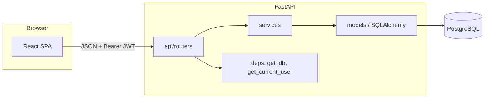

# Implementation Plan: 000-foundation

**Spec:** [spec.md](spec.md) · **Research:** [research.md](research.md) · **Data model:** [data-model.md](data-model.md) · **Contract:** [contracts/openapi.yaml](contracts/openapi.yaml)

## Summary

Set up the monorepo, the backend and frontend skeletons, the Docker Compose runtime (the only way to run, test and lint the app, Constitution IX) and CI. Implement registration, login and JWT auth, the seeded category catalog and the fixed `Pilar` enum. Every later feature builds on this skeleton.

## Technical Context

| | |
|---|---|
| Language | Python 3.12 (backend), TypeScript 5 (frontend) |
| Dependencies | fastapi, uvicorn, sqlalchemy 2, alembic, pydantic-settings, pwdlib[argon2], pyjwt, psycopg[binary]; react, react-router, @tanstack/react-query, vite |
| Storage | PostgreSQL 16 (dev and prod), SQLite in-memory (tests) |
| Testing | pytest, httpx TestClient, Vitest, Testing Library |
| Target | Docker Compose (`db`, `api`, `web`), host needs only Docker; evergreen desktop and mobile browsers |
| Constraints | Money as Decimal; schema portable across PG and SQLite (research R4) |

## Constitution Check

| Principle | Status | Notes |
|---|---|---|
| I. Traceability | ✅ | Auth isn't in the sprints and is justified in research R1. Categories follow RN002 |
| II. Fixed v1 scope | ✅ | No external identity provider, no bank integration |
| III. Test-first | ✅ | Contract tests T010–T013 come before T014+ |
| IV. Money | ✅ | `Pilar.percentual` is a Decimal |
| V. Data ownership | ✅ | `get_current_user` dependency. Cross-user test helper in conftest |
| VI. Simplicity | ✅ | No repository layer: services use the SQLAlchemy `Session` directly |
| VII. Baseline | ✅ | Matches the table |
| IX. Docker Compose | ✅ | `docker-compose.yml` with `db`, `api`, `web`; migrations on `api` startup; tests, lint and CI run in containers (research R5) |

## Architecture



- **Routers** handle HTTP mapping and Pydantic schemas only.
- **Services** hold use-case logic and business rules. They raise `DomainError(code, message, status)`.
- One exception handler turns `DomainError` and `RequestValidationError` into the constitution's error shape.

## Project Structure

```
backend/
├── pyproject.toml
├── alembic.ini
├── alembic/versions/
│   └── 0001_usuario_categoria.py      # tables + category seed
├── app/
│   ├── main.py                        # app factory, routers, exception handlers
│   ├── core/
│   │   ├── config.py                  # Settings (DATABASE_URL, JWT_SECRET, JWT_TTL)
│   │   ├── security.py                # hash/verify password, create/decode JWT
│   │   └── errors.py                  # DomainError + handlers
│   ├── db.py                          # engine, SessionLocal, Base
│   ├── deps.py                        # get_db, get_current_user
│   ├── domain/
│   │   └── enums.py                   # Pilar, TipoMovimentacao
│   ├── models/
│   │   ├── usuario.py
│   │   └── categoria.py
│   ├── schemas/
│   │   ├── auth.py
│   │   └── categoria.py
│   ├── services/
│   │   ├── auth_service.py
│   │   └── categoria_service.py
│   └── api/routers/
│       ├── auth.py
│       ├── usuarios.py
│       ├── categorias.py
│       └── pilares.py
└── tests/
    ├── conftest.py                    # app, client, db, auth_headers, other_user fixtures
    ├── contract/
    ├── integration/
    └── unit/
frontend/
├── package.json, vite.config.ts, tsconfig.json
└── src/
    ├── main.tsx, App.tsx              # router + QueryClientProvider
    ├── api/client.ts                  # fetch wrapper, bearer token, error shape
    ├── auth/AuthContext.tsx, RequireAuth.tsx
    ├── pages/LoginPage.tsx, RegisterPage.tsx, HomePage.tsx
    ├── components/Layout.tsx          # responsive shell with nav
    └── styles/                        # mobile-first CSS
backend/Dockerfile                     # python:3.12-slim, entrypoint: alembic upgrade head → uvicorn
backend/entrypoint.sh
frontend/Dockerfile                    # node:22-alpine, vite dev on 0.0.0.0
docker-compose.yml                     # db, api, web
.env.example                           # dev defaults; .env is git-ignored
.github/workflows/ci.yml               # (or Azure Pipelines equivalent)
```

## Key Design Notes

- API prefix: `/api/v1`. The Vite dev server proxies `/api` to `http://api:8000`, so the browser sees a single origin. CORS still allows the Vite origin for direct calls.
- Runtime (research R5): `docker compose up --build` is the only start command. `api` waits for a healthy `db`, applies migrations, then serves. All tests and linters run with `docker compose run --rm --no-deps <service> …`.
- `Pilar` is a `StrEnum` with a `percentual` property that returns a `Decimal`, and `calcular_limite(renda)`. This mirrors the Java example in Sprint 4 §3.5.
- The category seed runs as Alembic data migration `0001`, so every environment has the same catalog.
- A test fixture `other_user_headers` exists from the start so every later feature can write cross-user isolation tests (SC-002).

## Complexity Tracking

None.
