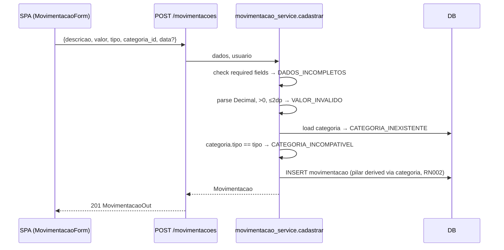

# Implementation Plan: 001-movimentacoes

**Spec:** [spec.md](spec.md) · **Research:** [research.md](research.md) · **Data model:** [data-model.md](data-model.md) · **Contract:** [contracts/openapi.yaml](contracts/openapi.yaml)

## Summary

Add the `Movimentacao` entity, together with the registration, category change and listing endpoints and the matching screens. The validation order in the service follows AD01: completeness, then valor, then categoria. Each alternative flow produces its own error code (research R3).

## Technical Context

Inherits the stack and structure from [000-foundation/plan.md](../000-foundation/plan.md). No new dependencies.

## Constitution Check

| Principle | Status | Notes |
|---|---|---|
| I. Traceability | ✅ | FR → RF/UC table in the spec. Open points are marked NEEDS CLARIFICATION, with provisional defaults in research R1 and R2 |
| II. Fixed v1 scope | ✅ | Manual entry only |
| III. Test-first | ✅ | T101–T105 come before T106+ |
| IV. Money | ✅ | `NUMERIC(12,2)`, Decimal in Python, string in JSON (research R4) |
| V. Data ownership | ✅ | Every query filters by `usuario_id`. Cross-user test T105 |
| VI. Simplicity | ✅ | No new abstractions |

## Flow (AD01 → code)



## Files

```
backend/app/models/movimentacao.py
backend/app/schemas/movimentacao.py         # MovimentacaoIn, MovimentacaoOut, MovimentacaoPage, CategorizarIn
backend/app/services/movimentacao_service.py # cadastrar, categorizar, listar, obter
backend/app/api/routers/movimentacoes.py
backend/alembic/versions/0002_movimentacao.py
backend/tests/contract/test_movimentacoes.py
backend/tests/integration/test_movimentacoes_flow.py
backend/tests/unit/test_movimentacao_validacao.py
frontend/src/api/movimentacoes.ts           # typed calls + TanStack Query hooks
frontend/src/pages/MovimentacoesPage.tsx    # list, filters, empty state
frontend/src/pages/NovaMovimentacaoPage.tsx # form
frontend/src/components/MovimentacaoForm.tsx
frontend/src/components/CategoriaSelect.tsx # filtered by tipo, shows pilar badge
frontend/src/components/PilarBadge.tsx
frontend/src/lib/money.ts                   # parse/format BRL strings ↔ API decimal strings
```

## Frontend Notes

- Routes: `/movimentacoes` (list) and `/movimentacoes/nova` (form).
- Form: a segmented ENTRADA/SAIDA control. Changing the type resets the category. `CategoriaSelect` loads `GET /categorias?tipo=…` and shows the pilar badge next to each option, so the user sees the effect of RN002. The amount input accepts "1.500,00" and `money.ts` converts it to `"1500.00"`.
- Server error codes map to field-level messages in pt-BR.
- List: a card layout on mobile and a table at ≥ 768 px. Inline category change through a select calls `PATCH …/categoria`.

## Complexity Tracking

None.
