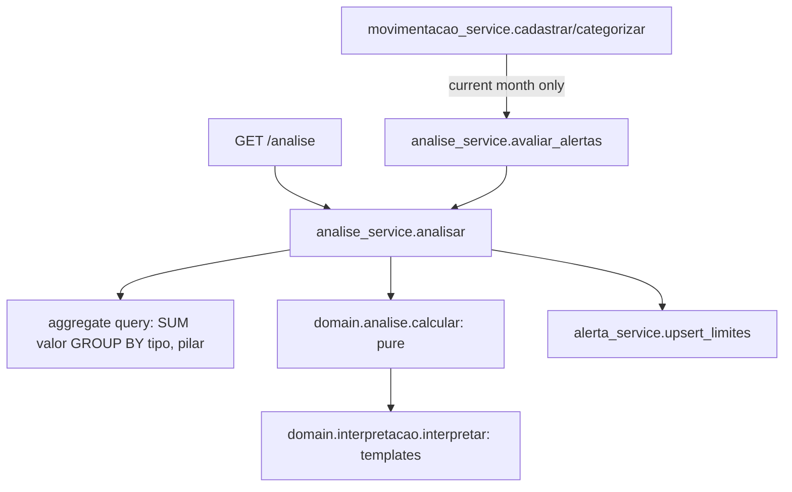

# Implementation Plan: 002-analise-50-30-20

**Spec:** [spec.md](spec.md) · **Research:** [research.md](research.md) · **Data model:** [data-model.md](data-model.md) · **Contract:** [contracts/openapi.yaml](contracts/openapi.yaml)

## Summary

Implement the 50-30-20 analysis as a pure domain function (`domain/analise.py`) fed by one aggregate query. Persist limit alerts with deduplication. Expose `GET /analise` and the alerts endpoints, and build the analysis dashboard and the alerts screen. Per research R3, also re-evaluate the current month after a movement is registered or recategorized.

## Technical Context

Inherits from [000-foundation/plan.md](../000-foundation/plan.md). No new backend dependencies. Frontend: CSS-only progress bars, no chart library (Constitution VI).

## Constitution Check

| Principle | Status | Notes |
|---|---|---|
| I. Traceability | ✅ | Every FR maps to an RF/UC. The open points (period, proactive trigger, Futuro semantics) are marked and have provisional defaults |
| II. Fixed v1 scope | ✅ | Fixed percentages come from the `Pilar` enum. Interpretation uses templates (research R5), no LLM |
| III. Test-first | ✅ | Domain unit tests T201–T203 and contract tests T204–T206 come before the implementation |
| IV. Money | ✅ | Decimal throughout. Percentages kept as Decimal with 4 decimal places |
| V. Data ownership | ✅ | Aggregation and alerts are filtered by `usuario_id`. Cross-user test in T207 |
| VI. Simplicity | ✅ | The analysis is not persisted (derived data). Single-table alerts |
| IX. Docker Compose | ✅ | Migration `0003` runs on `api` startup. No new service |

## Design



- `domain/analise.py`: `calcular(renda: Decimal, totais: dict[Pilar, Decimal], periodo) -> AnaliseFinanceira`. Pure, with no IO. This is where the fork/join from AD02 lives: an independent computation per pilar.
- `domain/interpretacao.py`: `interpretar(analise) -> list[InterpretacaoItem]`, using the templates from research R5 and the pt-BR formatters in `domain/formatacao.py` (`format_brl`, `format_pct`).
- `services/analise_service.py`: runs the query, calls `calcular`, upserts alerts and builds the response. `avaliar_alertas(usuario, hoje)` covers the proactive path.
- `services/alerta_service.py`: `upsert_limite(...)` following the research R2 rules, `listar` and `marcar_lido`.

## Files

```
backend/app/domain/analise.py
backend/app/domain/interpretacao.py
backend/app/domain/formatacao.py
backend/app/models/alerta.py                 # Alerta base + AlertaLimite
backend/app/schemas/analise.py
backend/app/schemas/alerta.py
backend/app/services/analise_service.py
backend/app/services/alerta_service.py
backend/app/services/movimentacao_service.py # + hook to avaliar_alertas (research R3)
backend/app/api/routers/analise.py
backend/app/api/routers/alertas.py
backend/alembic/versions/0003_alerta.py
backend/tests/unit/test_analise_calculo.py
backend/tests/unit/test_interpretacao.py
backend/tests/contract/test_analise.py
backend/tests/contract/test_alertas.py
backend/tests/integration/test_analise_alertas_flow.py
frontend/src/api/analise.ts, alertas.ts
frontend/src/pages/AnalisePage.tsx
frontend/src/pages/AlertasPage.tsx
frontend/src/components/PilarCard.tsx        # total / limit, progress bar, status
frontend/src/components/PeriodoSelector.tsx  # month prev/next + custom range
frontend/src/components/AlertasBell.tsx      # unread badge in Layout
```

## Frontend Notes

- `/analise`: a period selector at the top, then a summary row (renda, gastos, saldo), then three `PilarCard`s side by side on desktop and stacked on mobile. Each card has a progress bar against the limit that turns red when exceeded, with the percentage label and the value always shown as text (color is never the only signal). Below the cards, the interpretation items. An exceeded pilar shows an inline alert banner.
- The `DADOS_INSUFICIENTES` state shows the message and a link to register a movement.
- `/alertas`: a list with filters (unread / all), and each item can be marked as read. `AlertasBell` in `Layout` polls `GET /alertas?lido=false&limit=1` for `total_nao_lidos` when the window regains focus.

## Complexity Tracking

None.
