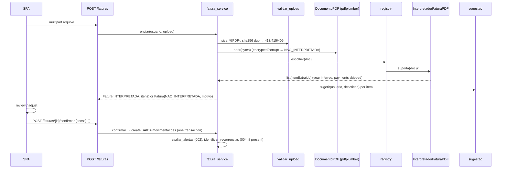

# Implementation Plan: 003-fatura-pdf

**Spec:** [spec.md](spec.md) · **Research:** [research.md](research.md) · **Data model:** [data-model.md](data-model.md) · **Contract:** [contracts/openapi.yaml](contracts/openapi.yaml)

## Summary

Accept a PDF upload, validate it by its content, and extract text once into a `DocumentoPDF`. Pick the first `InterpretadorFatura` whose `suporta()` matches, extract the items, infer the year, filter out payments and credits, and suggest categories. Persist the `Fatura` and its `ItemFatura` drafts. The user reviews them and confirms, which creates the SAIDA movements atomically and then re-evaluates alerts (002) and recurrences (004, once that feature exists).

## Technical Context

| | |
|---|---|
| New dependencies | `pdfplumber` (runtime), `python-multipart` (FastAPI uploads), `reportlab` (dev only, fixture generation) |
| Limits | 10 MB per file, synchronous parsing, raw file not stored |

## Constitution Check

| Principle | Status | Notes |
|---|---|---|
| I. Traceability | ✅ | FR → RF008/RF009/UC07/UC08. Δ changes to the class diagram (ItemFatura, CONFIRMADA) are justified in research R7 and in data-model |
| II. Fixed v1 scope | ✅ | Manual upload only, no bank API. Suggestions use rules (research R6), no AI. No OCR |
| III. Test-first | ✅ | Parser unit tests use generated fixtures (research R8). Contract tests come before the endpoints |
| IV. Money | ✅ | `"1.234,56"` is parsed with a dedicated `parse_valor_brl` into a Decimal |
| V. Data ownership | ✅ | Hash uniqueness is per user. 404 for other users' invoices |
| VI. Simplicity | ⚠️ justified | The `InterpretadorFatura` strategy is the abstraction the constitution explicitly allows. Only one implementation in v1 |
| IX. Docker Compose | ✅ | `pdfplumber` and `reportlab` go into the `api` image. Sample invoices are generated inside the container (quickstart). No new service |

## Design



## Files

```
backend/app/fatura/
├── __init__.py
├── documento.py               # DocumentoPDF.abrir(bytes) via pdfplumber
├── tipos.py                   # ItemExtraido, InterpretadorFatura Protocol
├── parsing.py                 # parse_valor_brl, parse_data_linha, inferir_ano (R4), deve_ignorar (R5)
├── normalizacao.py            # normalizar_descricao (shared with 004)
├── sugestao.py                # keyword table + history lookup (R6)
├── registry.py                # INTERPRETADORES = [InterpretadorFaturaPDF()]
└── interpretadores/
    └── generico.py            # InterpretadorFaturaPDF
backend/app/models/fatura.py   # Fatura, ItemFatura (+ marcar_interpretada / marcar_falha)
backend/app/models/movimentacao.py  # + fatura_id
backend/app/schemas/fatura.py
backend/app/services/fatura_service.py   # enviar, obter, listar, confirmar
backend/app/api/routers/faturas.py
backend/alembic/versions/0004_fatura.py
backend/tests/fixtures/gerar_faturas.py  # reportlab builders (R8)
backend/tests/unit/test_fatura_parsing.py
backend/tests/unit/test_interpretador_generico.py
backend/tests/unit/test_sugestao.py
backend/tests/contract/test_faturas.py
backend/tests/integration/test_fatura_flow.py
frontend/src/api/faturas.ts
frontend/src/pages/EnviarFaturaPage.tsx   # file picker / drop zone, errors, loop on FA01
frontend/src/pages/RevisarFaturaPage.tsx  # items table, category selects, include toggles, totals, confirm
frontend/src/pages/FaturasPage.tsx        # history (US4)
```

## Frontend Notes

- `/faturas/enviar`: `<input type="file" accept="application/pdf">` with a drag-and-drop area on desktop. A 415 error keeps the user on the page with the FA01 message, ready to pick another file (AD03 loop). `NAO_INTERPRETADA` shows the UC08 FA01 message and the reason.
- `/faturas/:id/revisar`: a table on desktop and cards on mobile. Each row has an include checkbox, date, description, amount, a `CategoriaSelect tipo=SAIDA` (from 001) pre-filled with the suggestion and marked "sugerida", and a live total of the included items. The confirm button is disabled while an included item has no category, and server `details.itens` highlights rows. On success, redirect to `/movimentacoes`.
- The review state lives in the client only until confirmation. The server receives the full set of adjustments in one call.

## Complexity Tracking

| Item | Why needed | Simpler alternative rejected because |
|---|---|---|
| `InterpretadorFatura` strategy + registry | Layouts vary per bank (Sprint 2 risk, Sprint 4 §3.4) | A single hard-coded parser would require rewrites for each new bank |
| `ItemFatura` draft table | AD03 requires user review before registration | Creating movements immediately would violate AD03 and SC-004 |
