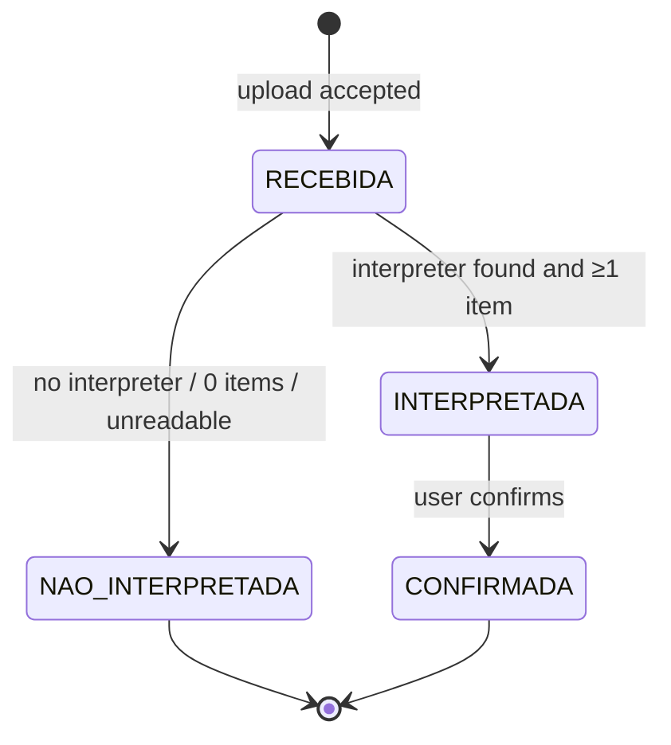

# Research: 003-fatura-pdf

## R1: PDF text extraction library

- **Decision:** `pdfplumber`, which uses `pdfminer.six` underneath.
- **Rationale:** it extracts text with positions (`extract_words`) and tables, which helps with column-based invoice layouts. It is pure Python, MIT licensed and maintained.
- **Alternatives:**
  - `pypdf`: plain text only, weaker layout handling.
  - `PyMuPDF`: fast, but AGPL-licensed.
  - `camelot` / `tabula`: table-only, and tabula needs Java.
- **Limits:** no OCR, so image-only PDFs fail. This is accepted and maps to UC08 FA01.

## R2: Interpreter strategy (FR-009, FR-010)

- **Decision:** a registry of `InterpretadorFatura` implementations, tried in order. The first whose `suporta(texto)` returns true interprets the invoice.

```python
class InterpretadorFatura(Protocol):           # «interface» in the class diagram
    nome: str
    def suporta(self, doc: DocumentoPDF) -> bool: ...
    def interpretar(self, doc: DocumentoPDF) -> list[ItemExtraido]: ...

class InterpretadorFaturaPDF(InterpretadorFatura):   # the generic line-pattern implementation
    # Matches lines like "12/10  UBER *TRIP  23,90" or "12 OUT  IFOOD *REST  45,00"
    LINHA = re.compile(r"^(?P<dia>\d{2})[/ ](?P<mes>\d{2}|[A-Z]{3})\s+(?P<desc>.+?)\s+(?P<valor>-?[\d.]+,\d{2})$")
```

- v1 ships `InterpretadorFaturaPDF` (generic). Bank-specific interpreters (`InterpretadorNubank`, …) are added later as new classes in `backend/app/fatura/interpretadores/` and registered in `registry.py`. Nothing else changes, as Sprint 4 §3.4 intends.
- `DocumentoPDF` wraps `pdfplumber` once: the text per page plus the words with coordinates. Interpreters never open files themselves.
- **Provisional default for FR-010:** the generic interpreter only. The team must collect 2–3 real (anonymized) invoices per target bank as fixtures. That decides whether specific interpreters are needed.

## R3: Upload validation (UC07 FA01)

| Check | Failure → response |
|---|---|
| Size ≤ 10 MB (read in chunks, abort early) | 413 `ARQUIVO_MUITO_GRANDE` |
| First bytes are `%PDF-` (magic number), regardless of name or content-type | 415 `ARQUIVO_NAO_PDF` |
| SHA-256 of the content is not already among this user's faturas | 409 `FATURA_DUPLICADA` |
| pdfplumber opens the file (it is not encrypted or corrupt) | 201, with `status = NAO_INTERPRETADA` and `motivo_falha` |

- The file is parsed synchronously within the request, since invoices are small (SC-002).
- **The raw file is not stored.** Only the name, hash, status and extracted items are kept (Constitution VI, and it limits sensitive data at rest). Re-interpretation needs a new upload.

## R4: Inferring the year of purchase lines

1. Look in the text for the due date ("Vencimento", "Data de vencimento") or the closing date ("Fechamento"), as `dd/mm/yyyy` or `dd MMM yyyy`.
2. Reference date = that date, or else the upload date.
3. For each line `dd/mm`: year = the reference year. If the resulting date is more than 31 days after the reference date, use year − 1. This handles December purchases on a January invoice.

## R5: Lines to ignore

Skip a line when its amount is negative or prefixed with `-`, or when the normalized description matches `PAGAMENTO|PAGTO RECEBIDO|ESTORNO|CREDITO|SALDO ANTERIOR|TOTAL|ANUIDADE DIFERENCIADA ESTORNO`. These patterns live in a module-level tuple so they can be extended.

## R6: Category suggestion (FR-005, deterministic)

Rules are applied in this order:
1. **The user's history:** the most frequent category the user gave to a movement with the same normalized description (uppercase, accents and digits removed, `*` and installment markers stripped). This reuses `normalizar_descricao()`, which is shared with feature 004.
2. **Keyword rules:** a static table in `backend/app/fatura/sugestao.py`, for example:

| Keywords (normalized) | Categoria |
|---|---|
| UBER, 99APP, CABIFY, POSTO, SHELL, IPIRANGA | Transporte |
| IFOOD, RAPPI, RESTAURANTE, LANCHONETE, BURGER | Restaurantes e delivery |
| NETFLIX, SPOTIFY, DISNEY, PRIME VIDEO, YOUTUBE | Assinaturas |
| SUPERMERC, MERCADO, ATACADAO, CARREFOUR, ASSAI | Alimentação (mercado) |
| FARMACIA, DROGARIA, DROGASIL, RAIA | Saúde |
| VIVO, CLARO, TIM, OI, NET  | Contas da casa |
| AMAZON, MERCADOLIVRE, SHOPEE, MAGALU | Compras |

3. Otherwise there is no suggestion (`null`), and the user must choose before confirming.

## R7: Status lifecycle



- **Δ against Sprint 4:** `CONFIRMADA` was added to `StatusFatura` so that an invoice cannot be imported twice (FR-008).
- `RECEBIDA` is transient, because interpretation happens in the same request. It is kept for fidelity with the class diagram, and in case parsing moves to a background job later.

## R8: Test fixtures

- Generate synthetic invoice PDFs in tests with `reportlab` (a dev dependency): a generic layout, a December/January rollover, payments and refunds, an installment line, an empty invoice, an image-only page, and an encrypted file.
- Real invoices, if any are provided, live in `backend/tests/fixtures/faturas/real/`. That folder is git-ignored and anonymized, and the tests that use it are skipped when the files are absent.
