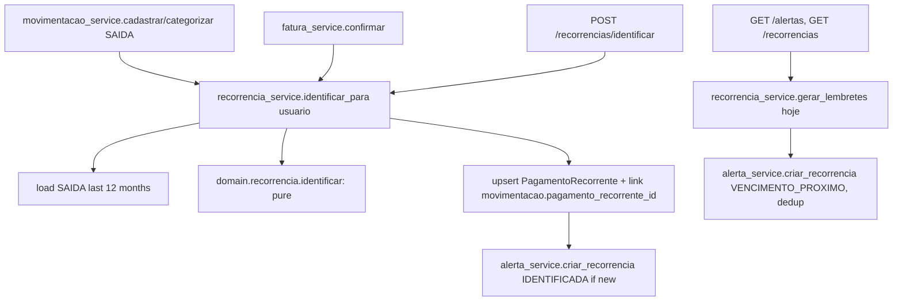

# Implementation Plan: 004-recorrencias

**Spec:** [spec.md](spec.md) · **Research:** [research.md](research.md) · **Data model:** [data-model.md](data-model.md) · **Contract:** [contracts/openapi.yaml](contracts/openapi.yaml)

## Summary

Implement `IdentificadorRecorrencia` as a pure domain function (`domain/recorrencia.py`) and wrap it in `recorrencia_service`. The service loads 12 months of SAIDA, upserts `PagamentoRecorrente` rows, links movements and issues `AlertaRecorrencia` with deduplication. Identification runs after movement and invoice changes and on demand. Due-date reminders are evaluated lazily, with no scheduler. The frontend gets a recurrences screen, and recurrence alerts join the existing alerts screen.

## Technical Context

| | |
|---|---|
| New dependency | `python-dateutil` (month arithmetic in research R3) |
| Reuses | `normalizar_descricao` (003), `Alerta` single-table inheritance and `alerta_service` (002), `CategoriaRef` and `PilarBadge` (001) |

## Constitution Check

| Principle | Status | Notes |
|---|---|---|
| I. Traceability | ✅ | FR → RF010/RF011/UC09/UC10. Dismissal (US5) has no source and is marked NEEDS CLARIFICATION |
| II. Fixed v1 scope | ✅ | Heuristic rules, no ML or LLM. No payment execution, alerts only |
| III. Test-first | ✅ | Pure-function unit tests and the reference dataset (research R6) come before the service |
| IV. Money | ✅ | `valor_medio` is the Decimal mean, quantized to 0.01 half-up |
| V. Data ownership | ✅ | History query and recurrences filtered by `usuario_id`. Cross-user test |
| VI. Simplicity | ✅ | No job scheduler (lazy reminders, research R4). FK instead of a link table (research R7) |

## Design



Upsert rules for each `Candidato`:
- **No row** for `descricao_normalizada`: create it and emit an `IDENTIFICADA` alert.
- **Row exists and is not dismissed:** update `valor_medio`, `frequencia`, `ultima_ocorrencia`, `proximo_vencimento`, `qtd_ocorrencias`, `categoria_id` and the links. No new identification alert.
- **Row exists and is dismissed:** update the statistics only, with no alerts.
- **Row exists but its group no longer qualifies:** keep the row. It becomes inactive naturally (research R3).

## Files

```
backend/app/domain/recorrencia.py            # Frequencia, Candidato, identificar, classificar, valores_semelhantes, projetar
backend/app/fatura/normalizacao.py           # (exists from 003; create if 004 is built first)
backend/app/models/pagamento_recorrente.py
backend/app/models/alerta.py                 # + AlertaRecorrencia
backend/app/models/movimentacao.py           # + pagamento_recorrente_id
backend/app/schemas/recorrencia.py
backend/app/services/recorrencia_service.py  # identificar_para, gerar_lembretes, listar, obter, descartar
backend/app/services/alerta_service.py       # + criar_recorrencia; listar() calls gerar_lembretes first
backend/app/services/movimentacao_service.py # + hook
backend/app/services/fatura_service.py       # + hook
backend/app/api/routers/recorrencias.py
backend/alembic/versions/0005_recorrencia.py
backend/tests/fixtures/historico_recorrencias.py
backend/tests/unit/test_recorrencia_dominio.py
backend/tests/unit/test_recorrencia_dataset.py
backend/tests/contract/test_recorrencias.py
backend/tests/integration/test_recorrencias_flow.py
frontend/src/api/recorrencias.ts
frontend/src/pages/RecorrenciasPage.tsx
frontend/src/components/RecorrenciaCard.tsx
frontend/src/pages/AlertasPage.tsx           # + render RECORRENCIA alerts, link to the recurrence
```

## Frontend Notes

- `/recorrencias`: tabs for Ativos, Inativos and Descartados, plus an "Analisar histórico agora" button that calls `POST /recorrencias/identificar` and shows "Nenhum pagamento recorrente identificado" when the result is empty (UC09 FA01).
- `RecorrenciaCard` shows the description, category with its pilar badge, frequency label, average amount, next due date and "vence em N dias" (highlighted when N ≤ 3). Expanding a card shows the source movements (`GET /recorrencias/{id}`). Its menu has "Não é recorrente" (US5).
- `AlertasPage` shows RECORRENCIA alerts with an icon and links them to `/recorrencias#id`.

## Complexity Tracking

None.
